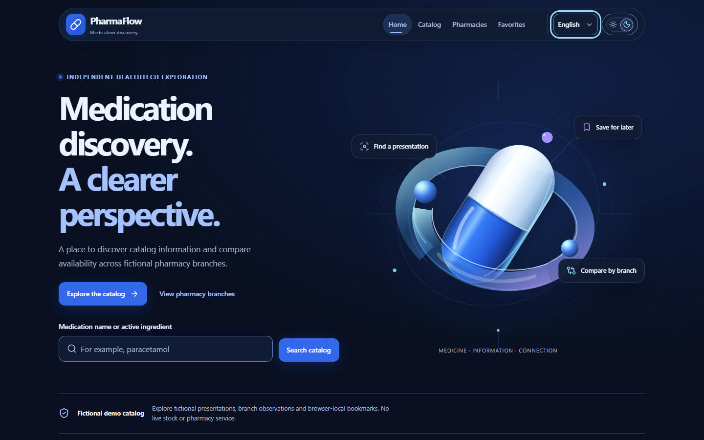

# Yordan Andres Chavez Barros · Andrew

### HealthTech Software Developer

I build web applications for healthcare, drawing on more than 3 years of professional experience primarily in healthcare software development. Based in Chile and open to international opportunities.

React · TypeScript · Angular 
Python · Django · ASP.NET Core / C# 
PostgreSQL · MongoDB · Docker

**[Try PharmaFlow](https://pharmaflow-oux0.onrender.com)** · [Source code](https://github.com/YoAndrew21/pharmaflow)

**English** | [Español](README_ES.md) | [日本語](README_JA.md)

## Featured Projects

### PharmaFlow — Full-Stack HealthTech Portfolio Project

An independent medication discovery application built with React, TypeScript, ASP.NET Core / C#, and PostgreSQL 18.

- **Product:** medication catalog, search and filters, medication details, availability across fictional pharmacy branches, and pharmacy details and opening hours.
- **Experience:** browser-local favorites, English / Spanish / Japanese, light and dark themes, a responsive UI, and an accessibility-oriented implementation.
- **Engineering:** same-origin production architecture, Docker deployment on Render with Neon PostgreSQL, an explicit database release process, and a read-only PostgreSQL runtime role. Built with Vite, Entity Framework Core, and Npgsql.

**Validated testing snapshot:** 281 frontend tests passed · 360 backend tests passed.

Uses fictional demo data. It is not a real medical, dispensing, or patient system and does not integrate with real pharmacies.

**[Live Demo](https://pharmaflow-oux0.onrender.com) · [Repository](https://github.com/YoAndrew21/pharmaflow)**

### School Nursing System

A lightweight web application created to digitize a real paper-based workflow in a school nursing room, including automation of part of the school accident declaration process. It demonstrates a pragmatic approach to solving a concrete operational problem.

## Professional Background

I'm a Software Engineer and Programmer Analyst with experience in pharmacy-related software, healthcare logistics and WMS, clinical systems, oncology-related software, and ERP integrations. My work spans functional analysis, frontend and backend development, API integration, databases, QA and testing, and maintenance of existing applications.

Professional code developed for employers is private and is not part of this GitHub. Public repositories here contain my own code and independent projects.

## Tech Stack

- **Frontend:** React · TypeScript · Angular
- **Backend:** Python · Django · ASP.NET Core / C#
- **Data:** PostgreSQL · MongoDB
- **Infrastructure:** Docker

I have previous experience with C# / .NET and am currently strengthening that knowledge through the development of PharmaFlow.

## Currently Learning & Languages

I'm studying healthcare interoperability and HL7 FHIR, advanced React patterns, and modern software architecture. In the long term, I hope to contribute to international HealthTech projects, including in Japan.

- **Spanish:** native
- **English:** technical / documentation
- **Japanese:** beginner, currently studying with a private teacher

## Beyond Code

I'm also a self-taught pianist and musician.
